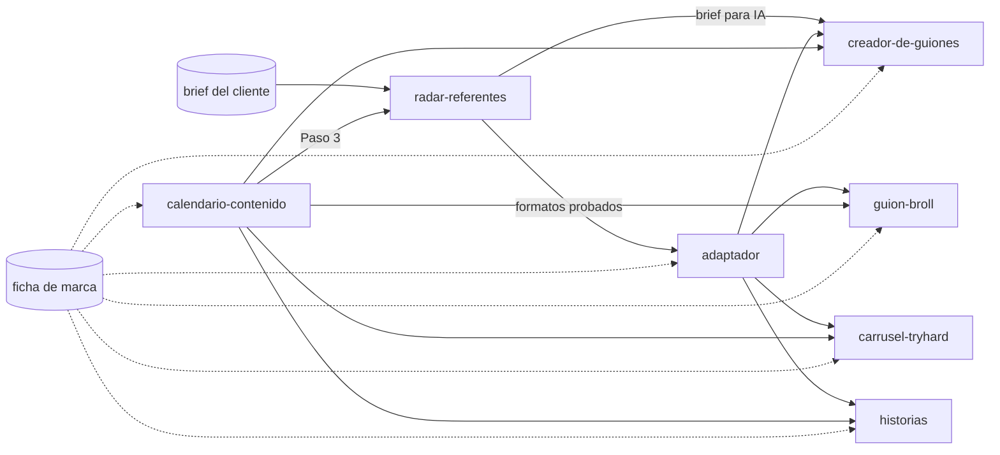
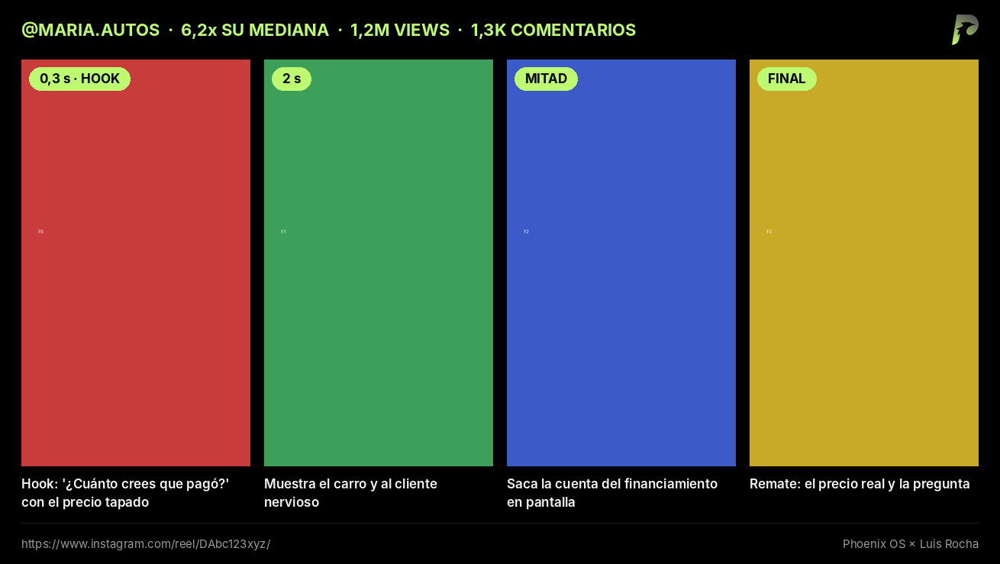
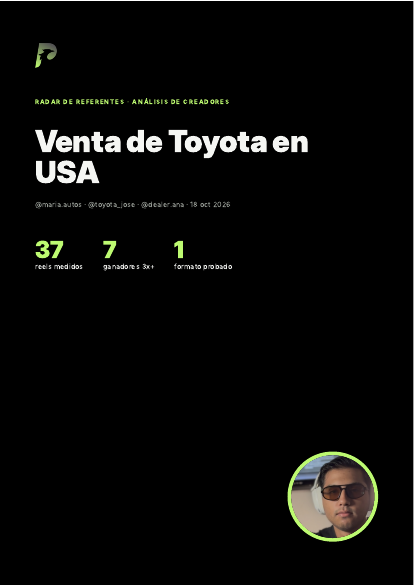
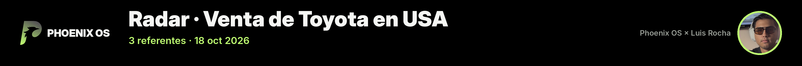

# Phoenix OS Skills by ROCHA

Las skills de contenido del equipo de Phoenix OS, con todo el criterio que construimos: cómo leemos a los referentes de un nicho, cómo adaptamos lo que funciona sin copiar, y cómo producimos guiones, carruseles y stories que suenan humanos, dicen la verdad y piden una sola acción.

> **La regla que gobierna todo el paquete: el mecanismo se copia, el contenido nunca.**

Hecho por Luis Rocha para el equipo de Phoenix OS. La foto, el logo y la marca Phoenix OS × Luis Rocha son de uso exclusivo de Phoenix OS.

---

## Qué trae

| Skill | Qué hace | Se activa cuando pides… |
|---|---|---|
| **radar-referentes** | Parte **siempre del brief del cliente** (contexto, oferta y avatar) y analiza 3–5 creadores del nicho contra ese brief: puntaje outlier en código, capturas cuadro por cuadro, formatos probados, qué no copiar e ideas para grabar. Entrega PDF, imagen para Miro y brief para IA **con la marca Phoenix OS × Luis Rocha** | "Hazme un radar para {cliente}" + su brief y los @ |
| **carrusel-tryhard** | Carruseles de nivel alto para cualquier marca. Pregunta el fin del carrusel (para decidir CTA y neuromarketing), el concepto, la marca y las referencias visuales; entrega PNG 1080×1350 + caption | "Hazme un carrusel de…", "una portada para…", "adapta esta referencia" |
| **adaptador** | **El criterio.** Convierte referencias o ideas en contenido propio con 5 pasos (mecanismo → filtro → traducción → auditoría de verdad → enrutar). Es dueño de la ficha de marca | "Mira este reel, adáptalo", "dame ideas de contenido", "da de alta esta marca" |
| **creador-de-guiones** | Guiones hablados de 15–60 s que suenan humanos y son objetivos | "Guion para un reel de…", "conviérteme este brief en guion" |
| **guion-broll** | Guiones de B-roll con voz en off: lo que se dice, lo que se ve y la lista de planos | "Video de producto sin cara", "B-roll con voz en off" |
| **historias** | Secuencias de Stories 9:16 con stickers, safe zones y PNG | "Hazme unas historias de…" |
| **calendario-contenido** | Calendario del mes con método: 10 dolores → pilares → formatos ganadores (radar) → semana tipo | "Arma el calendario de…", "ordena lo que ya grabó el cliente" |

### Cómo se conectan



---

## Instalación

Instala **las 7 juntas**: se pasan trabajo entre ellas.

### Opción A — En Claude (web o escritorio), una persona

1. Activa la ejecución de código (Settings → Capabilities).
2. Descarga los `.zip` de la carpeta [`dist/`](dist/).
3. **Customize → Skills → + → Create skill → Upload a skill**, uno por uno (los 7). En planes Team/Enterprise, cada skill se puede **compartir** con el equipo desde el menú ⋯ de la skill.

[Guía oficial](https://support.claude.com/en/articles/12512180-use-skills-in-claude)

### Opción B — Claude Code

```bash
claude plugin marketplace add luisrochagr/phoenix-os-skills
claude plugin install phoenix-os@phoenix-os-skills
```

### Opción C — Todo el equipo en Claude como marketplace (Team o Enterprise)

Claude solo sincroniza marketplaces desde repos **privados o internos**, y este repo es público. Para el equipo: crea una **copia privada** (GitHub → New repository → *Import a repository* con la URL de este repo), instala la **Claude GitHub App** en esa copia y un Owner la conecta en **Organization settings → Plugins & skills → Marketplaces → Add plugins → Sync from GitHub**. Con **Sync automatically**, cada cambio que suba la versión en `plugins/phoenix-os/.claude-plugin/plugin.json` llega a todos. [Guía oficial](https://support.claude.com/en/articles/13837433-manage-plugins-for-your-organization)

En Claude Code las skills quedan como `/phoenix-os:radar-referentes`, `/phoenix-os:carrusel-tryhard`, etc., y en local hace falta Python 3.10+, `pip install pillow numpy playwright pypdf`, `playwright install chromium` y Node/npm (para las fuentes).

---

## Regla del radar: el input es el brief del cliente

El radar no arranca sin un brief con **contexto breve, oferta y avatar** (dolores con sus palabras), además de los referentes, el idioma y quién graba. Puede ser el formulario de [`references/brief-cliente.md`](plugins/phoenix-os/skills/radar-referentes/references/brief-cliente.md), la transcripción de la llamada o la ficha de marca. Cada idea del reporte ataca un dolor del avatar y cierra con el CTA de la oferta; si no, no entra.

## Primer uso: la ficha de marca

Todas las skills (menos el radar) trabajan sobre la **ficha de marca** del cliente: voz, avatar, dolores, pruebas verificables, keyword del CTA, prohibiciones y sistema visual.

1. Pídele a Claude: *"Da de alta la marca {cliente}"*. La skill `adaptador` hace las preguntas y te entrega `marca-{cliente}.md`.
2. Guarda ese archivo en el **proyecto de Claude del cliente** (conocimiento del proyecto). Desde ahí lo leen todas las skills.
3. Lo que no se sabe queda como `POR CONFIRMAR`. Nada se inventa.

---

## Ejemplos

```text
Hazme un radar para {cliente}. Te paso su brief (contexto, oferta y avatar) y los referentes: @cuenta1 @cuenta2 @cuenta3.

Carrusel para {marca}: quiero leads, que comenten GUÍA. Te adjunto 2 referencias de diseño.

Mira este reel [link]. Adáptalo a la ficha de {marca} y pásalo a guion.

Arma el calendario de noviembre de {marca}. Usa el radar que hicimos.
```

---

## La marca en los entregables del radar

El radar sale siempre con la marca **Phoenix OS × Luis Rocha** (negro, lima `#BDFA71`, Inter / Inter Display, símbolo P y la foto de Luis), sin adjuntar nada: los activos viven en [`radar-referentes/assets/`](plugins/phoenix-os/skills/radar-referentes/assets/) y todo se arma con `scripts/marca.py`.

| Tira de 4 cuadros | Portada del PDF |
|---|---|
|  |  |



*(Ejemplos con datos de prueba.)*

---

## Mantener el repo

```
.claude-plugin/marketplace.json        catálogo (lo que lee Claude al sincronizar)
plugins/phoenix-os/
  .claude-plugin/plugin.json           nombre y VERSIÓN del plugin
  skills/<skill>/SKILL.md              cada skill + references/, scripts/, assets/
dist/*.zip                             skills empaquetadas para subir a mano (Opción A)
herramientas/sincronizar.py            copia archivos compartidos, valida y arma dist/
docs/                                  imágenes de este README
REVISION.md                            qué se corrigió en la revisión y qué queda pendiente
```

Para cambiar algo:

1. Edita la skill. Los archivos compartidos se editan **solo en su copia maestra**:
   - ficha de marca → `adaptador/references/ficha-marca.md`
   - scripts de diseño → `carrusel-tryhard/scripts/{efectos,fuentes,render}.py`
2. `python herramientas/sincronizar.py` (copia, valida y regenera `dist/`).
3. Sube la versión en `plugins/phoenix-os/.claude-plugin/plugin.json` (1.0.0 → 1.0.1 para arreglos, 1.1.0 para algo nuevo).
4. Commit y push a `main`.

Las fuentes Inter se distribuyen bajo SIL Open Font License 1.1 (ver `assets/fonts/LICENSE-Inter.txt`).
